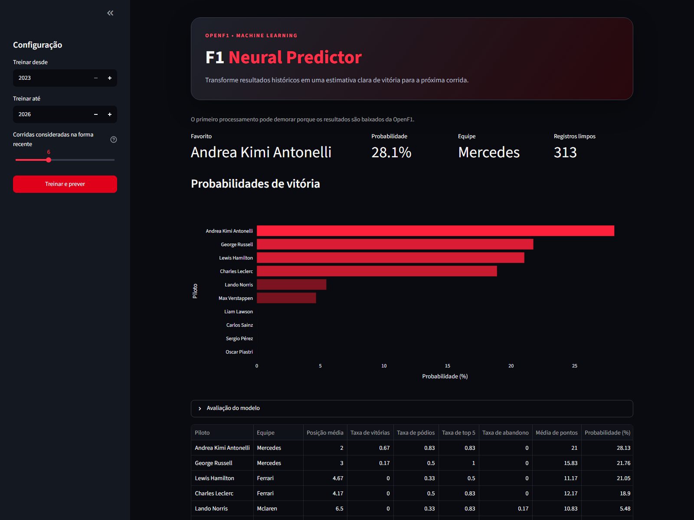

# F1 Neural Predictor

[](https://www.python.org/)
[](LICENSE)

A simple Streamlit app that estimates each driver's chance of winning the next
Formula 1 race. It downloads race results, builds recent-form features, and
trains a small neural network with scikit-learn.

This is an educational project. The probabilities are not betting advice.



## What the app does

- Shows the win probability for every active driver.
- Checks the model by race: did the top pick win? (top-1)
- Compares the model with a simple baseline based on average points.
- Lets you download the table as a CSV.

## How to run

You need Python 3.12 or newer.

```powershell
python -m venv .venv
.\.venv\Scripts\Activate.ps1
pip install -r requirements.txt
streamlit run app.py
```

On Linux or macOS, activate the environment with `source .venv/bin/activate`.

Open `http://localhost:8501`, choose the period in the sidebar, and click
**Treinar e prever** (Train and predict). The first run downloads the data and
can take a few minutes.

## How it works

1. **Download:** get the results of completed races from OpenF1. If OpenF1
   fails, the app uses Jolpica as a backup.
2. **Recent form:** for each driver, average their last races (position, wins,
   podiums, top 5 finishes, retirements, and points).
3. **Train:** a small neural network learns which drivers won. It only uses
   data from earlier races, so the race being predicted is not included.
4. **Predict:** the model gives a score to each driver. The app then turns the
   scores into percentages that add up to 100%.

The model trains on 80% of the races and tests on the last 20%. Races are kept
whole, so drivers from the same race never appear in both sets.

## Project structure

```text
f1-neural-predictor/
├── app.py                    # Streamlit app
├── predictor.py              # data, model, and prediction
├── docs/screenshot.png       # app screenshot
├── .streamlit/config.toml    # dark theme
├── requirements.txt
├── LICENSE
└── README.md
```

## Limitations

- Free OpenF1 data starts mainly in 2023.
- The model does not use qualifying, circuit, weather, or car updates.
- These probabilities are an educational estimate, not a guarantee.

## Tech stack

Python, pandas, NumPy, scikit-learn, Streamlit, Plotly, OpenF1, and Jolpica.

The app interface and code comments are in Portuguese.
